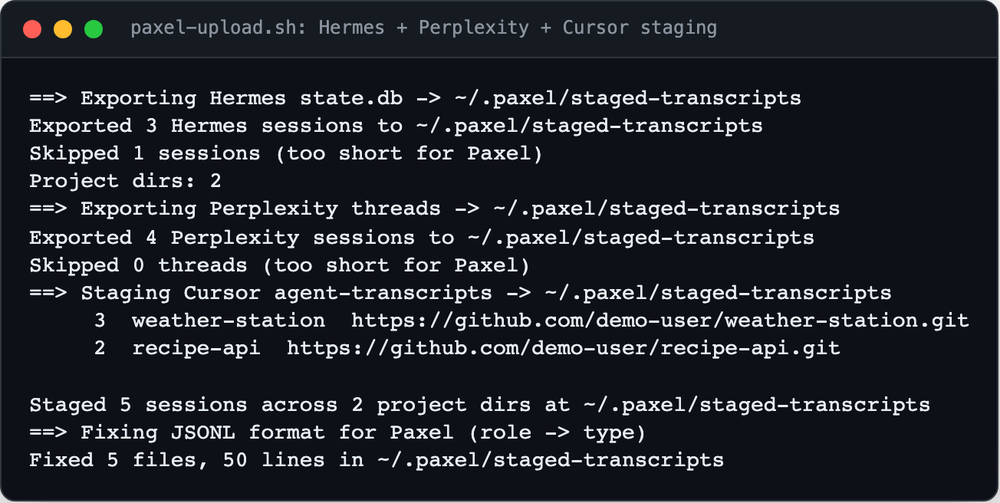

<div align="center">

<h1>yc-paxel</h1>

<p><b>Cursor, Hermes and Perplexity sessions, ready for Paxel.</b></p>

<p><i>YC Paxel reports on how you work with coding agents, but it only reads Claude Code's transcript layout. This converts the other agents' sessions into it.</i></p>

<h6>


</h6>

<a href="#install"><b>Install</b></a> ·
<a href="#usage"><b>Usage</b></a> ·
<a href="#how-it-works"><b>How it works</b></a>

<br><br>



<sub>Real output of the staging steps, run against made-up sample transcripts in a throwaway home folder (shown as <code>~</code>). Nothing uploaded.</sub>

</div>

<br>

## Why

[YC Paxel](https://paxel.ycombinator.com) expects one folder per project, a
`sessions-index.json` in each, and JSONL lines with a top-level `"type"`. Cursor keeps its
agent transcripts per workspace with `"role"` instead, Hermes keeps sessions in a SQLite
database, and Perplexity threads live on the web or in an export. These scripts put all
three into Paxel's layout, grouped by git repo, and then run Paxel's own uploader.

## Install

Needs Python 3.10+ (standard library only) and Docker or [Colima](https://github.com/abiosoft/colima)
for the Paxel uploader. Paxel creates its token at `~/.paxel/token` on the first upload.

```bash
git clone https://github.com/parthchandak02/yc-paxel.git
cd yc-paxel
```

To use it as a Cursor skill, link it in: `ln -s "$(pwd)" ~/.cursor/skills/yc-paxel`.

## Usage

```bash
bash scripts/paxel-upload.sh --cursor --all                                  # Cursor agent-transcripts
bash scripts/paxel-upload.sh --hermes-db --all                               # Hermes ~/.hermes/state.db
bash scripts/paxel-upload.sh --perplexity-pro --all                          # Perplexity via the perplexity-pro CLI
bash scripts/paxel-upload.sh --perplexity-dir ~/Downloads/pplx-export --all  # Perplexity from exported JSON/Markdown
bash scripts/paxel-upload.sh --all-agents --since 30d --all                  # everything, last 30 days, one report
```

The report link (`results/<id>/v3`) is printed at the end and kept in `~/.paxel/logs/`.

## How it works

1. **Export.** `export-hermes-sessions.py` reads the `sessions` and `messages` tables
   (cli, subagent, whatsapp, cron, tui and telegram sources by default) and turns tool calls
   into `tool_use` and `tool_result` blocks. `export-perplexity-sessions.py` reads Perplexity's
   GDPR export, role-based `messages[]` or `turns[]` files, or pulls live threads with
   `perplexity-pro`. Sessions with fewer than four messages are skipped, since Paxel
   rejects them.
2. **Stage.** `stage-transcripts.py` decodes each Cursor workspace folder back to a path,
   or infers one from paths mentioned in the transcript, finds the git root and copies the
   session under that repo with a `sessions-index.json`.
3. **Fix.** `fix-format.py` adds the top-level `"type"` Paxel requires to any line that only has `"role"`.
4. **Upload.** The wrapper starts Colima if Docker isn't running and runs Paxel's
   `upload.sh` with `TRANSCRIPT_DIR` pointed at the staging folder, which must sit under
   `$HOME` so Docker can mount it.

**What leaves your machine:** the upload sends session text, file paths and git metadata to
Paxel. Source code stays local. Use `--since`, `--no-repo` or a single agent flag to narrow
it, and never commit `~/.paxel/token`, staged transcripts or your `path-mappings.json`.

<details>
<summary><b>All options</b></summary>

| `paxel-upload.sh` option | |
|---|---|
| `--cursor` | Stage Cursor agent-transcripts (the default if no agent flag) |
| `--hermes-db` | Export Hermes `state.db` sessions |
| `--hermes-db-sources LIST` | Comma-separated Hermes sources to include |
| `--perplexity-pro` | Live Perplexity export via `perplexity-pro` |
| `--perplexity-dir DIR` | Perplexity JSON/Markdown export folder |
| `--all-agents` | Cursor, Hermes and Perplexity (`perplexity-pro`) together |
| `--filter REGEX` | Only Cursor sessions whose repo or workspace matches |
| `--stage-dir DIR` | Staging folder (default `~/.paxel/staged-transcripts`) |
| `--no-clean` | Keep what is already staged |
| `--all`, `--since DUR`, `--no-repo`, `-- ...` | Passed through to Paxel |

| Environment | |
|---|---|
| `PAXEL_STAGE_DIR` | Default staging folder |
| `PAXEL_PATH_MAPPINGS` | JSON mapping Cursor workspace folder names to real paths (see `config/path-mappings.example.json`) |
| `HERMES_FALLBACK_PATH` | Project for Hermes sessions with no `cwd` or git root (default `~/.hermes`) |

</details>

<details>
<summary><b>Troubleshooting</b></summary>

| Symptom | Fix |
|---|---|
| Docker daemon isn't running | `colima start` or open Docker Desktop |
| No sessions found | Run an export first; check `TRANSCRIPT_DIR` points at the staging folder |
| All sessions "too short" | Re-run `fix-format.py` on the staging folder |
| Colima can't read the staging folder | Keep it under `$HOME`, not `/tmp` |
| Missing git metadata | Make sure `originalPath` in `sessions-index.json` is a git repo |

</details>

<details>
<summary><b>Project layout</b></summary>

```
scripts/paxel-upload.sh                 Export, stage, fix and upload in one command
scripts/stage-transcripts.py            Cursor agent-transcripts -> Paxel layout
scripts/export-hermes-sessions.py       Hermes state.db -> Paxel JSONL
scripts/export-perplexity-sessions.py   Perplexity exports or live threads -> Paxel JSONL
scripts/fix-format.py                   Adds the top-level "type" field
config/path-mappings.example.json       Template for Cursor folder-name overrides
SKILL.md                                Instructions when used as a Cursor skill
```

</details>

<br>

<div align="center">
<sub>Python standard library and a bash wrapper around Paxel's uploader. Not affiliated with Y Combinator.</sub>
</div>
